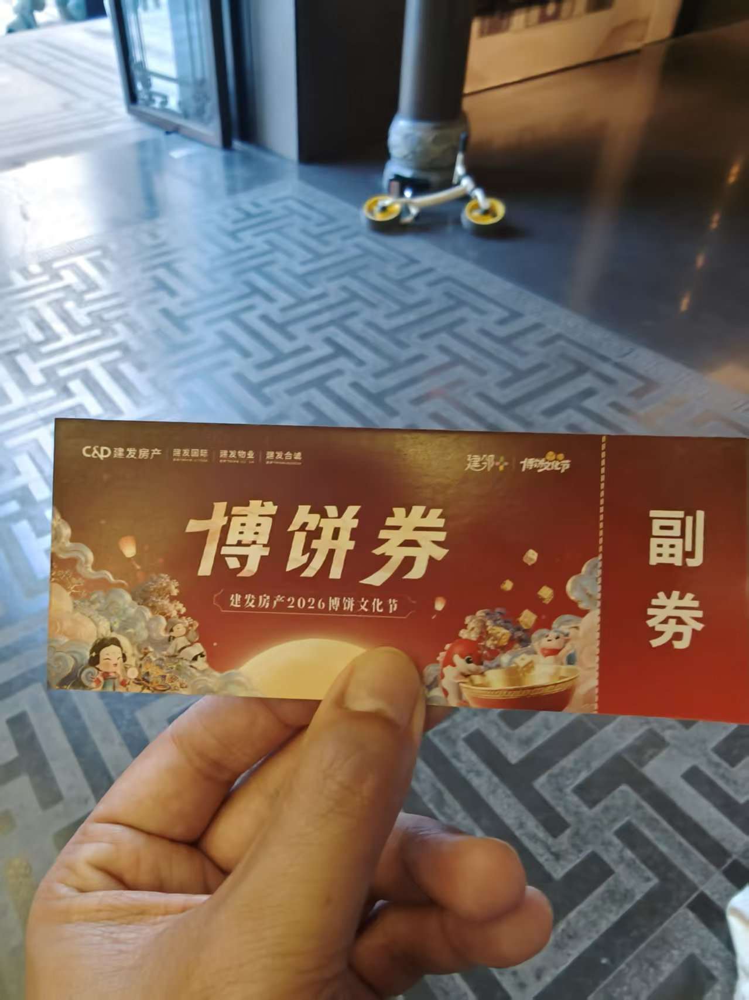
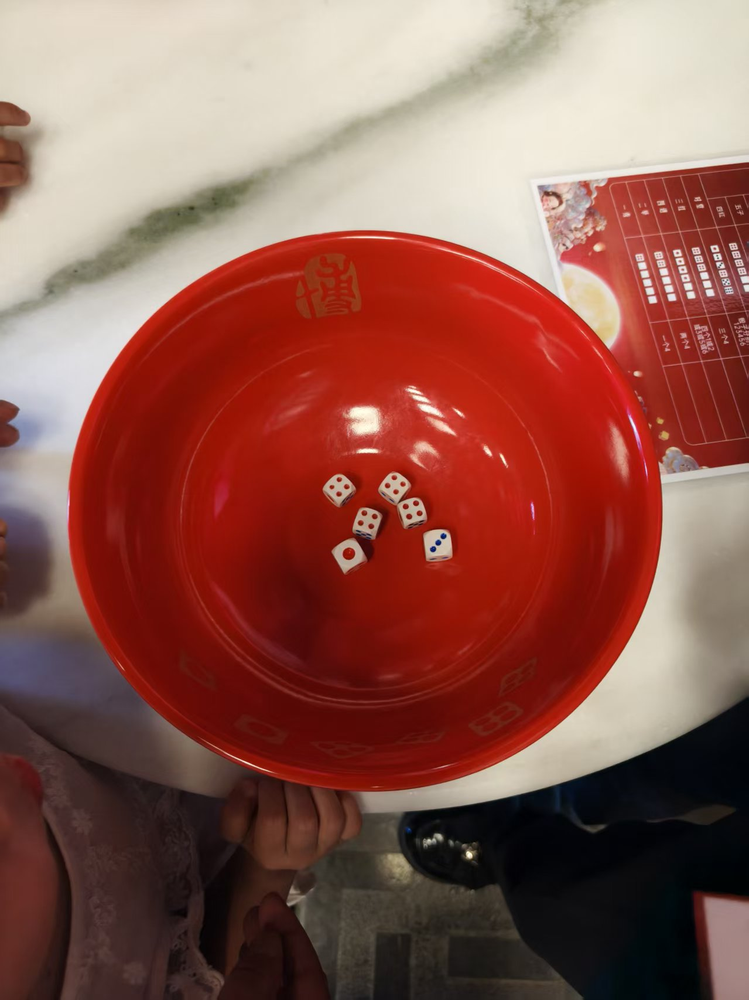
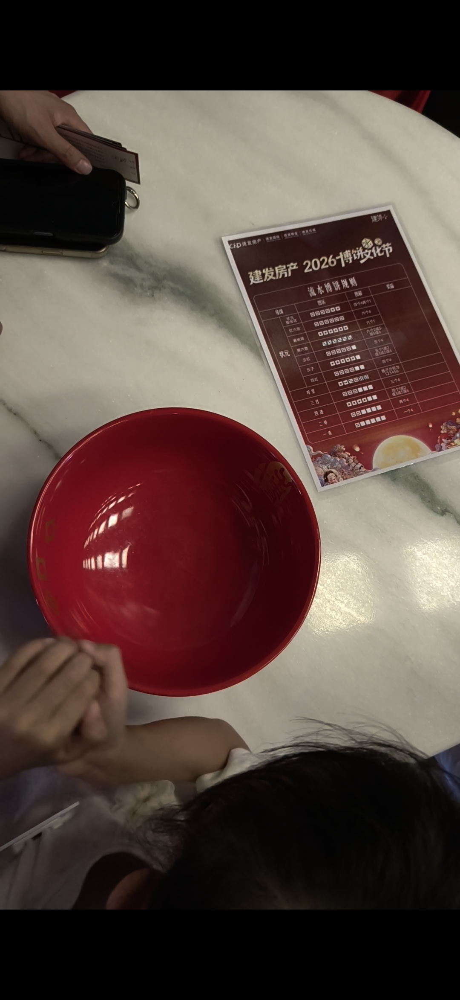

# 博饼

中秋还没到，小区物业的博饼先开了。前门大厅摆了三张圆桌，中间一只大红碗，六个骰子在里头滚。手里这张券印着"建发房产2026博饼文化节"，副券还没撕。

博饼这玩法，福建人熟。传说是郑成功屯兵厦门那会，部将洪旭为了安抚士兵中秋思乡，用六颗骰子配月饼设的局，后来从军营流到民间，闽南一带年年中秋都玩。龙岩在闽西，不算发源地。可开发商年年搞，小区住户也跟着热闹。图个彩头。

规则不复杂。六颗骰子往红碗里扔，看点数定等级，关键看红色的四点出了几个。出一个是一秀，出两个叫二举。三个四点是三红，四个四点凑成四红，那就是状元。除了数四点，对堂也值钱，一二三四五六各来一个。碗得够大够深，骰子弹出去不算数，得重扔。

桌上摆着规则单，每个等级对应什么奖品写得明白，状元最大，一秀最小。奖品从大米、食用油到纸巾、牙膏，全是过日子用得上的。没人真指望靠这个发财。

今天带了一家人去。小朋友抢着扔，手小捏不住骰子，撒得满桌都是，惹得旁边阿姨直笑。我手气一般，扔了好几轮，最高也就三红。最后兑了一包卷纸、一包抽纸。东西不值几个钱，可一家人围着一只碗喊点数的劲头，比东西值钱。回去的路上，小朋友抱着那包卷纸，说是战利品，不让碰。

平时大家各回各家，电梯里碰了面也未必打招呼。博饼这天不一样，一张桌子坐六七个人，你扔完我接，骰子撞碗的叮当声里，邻居就聊上了。谁家孩子上几年级，谁家老人回老家了，几句话的工夫。日子平常，难得有个由头让陌生人坐成一桌，卷纸也能卷出笑声。

你那边中秋有什么玩的？
