# 隐匿在城市中的田园生活

中学课本里陶渊明的《归园田居》，写的是多少人心里头那点念想。城越建越大，楼越住越高，这念想反倒越来越重了。

没想到它离我这么近。姑妈家的自建房，离我新家直线不过五百米，下个坡遛个弯就到。四层小楼，一楼拖着三百来平的院子，种满瓜果蔬菜，养鸡养鱼。今年姑妈喊我去摘葡萄，我乐颠颠就去了，跟我一道过过这田园日子。

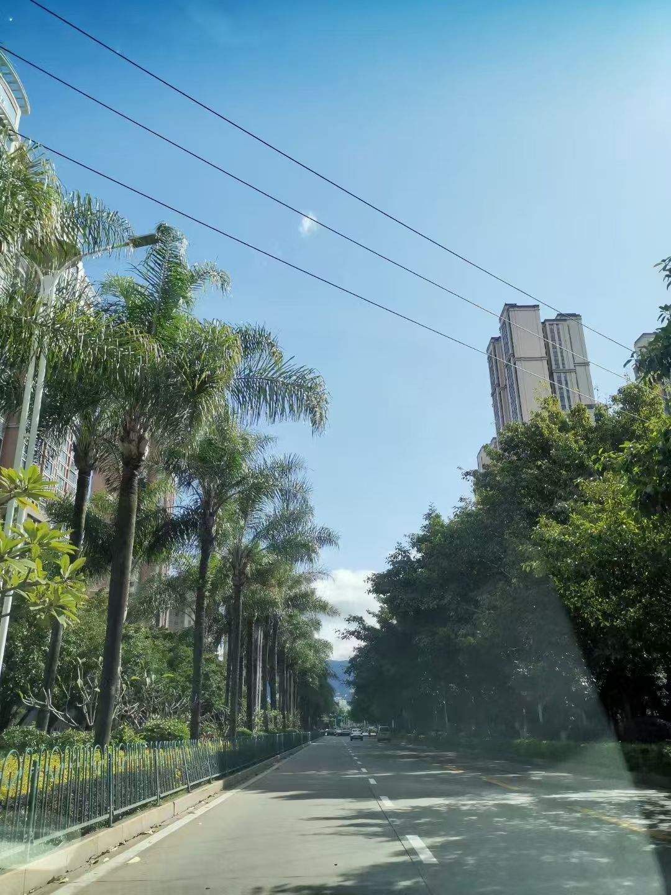

姑丈从前是种葡萄的好手，退了休没撂下这手艺，在院子里拾掇出三样品种。我只认得巨峰。一串串紫黑紫黑，挂在架上，没打过农药，皮上覆着层薄白霜，摘一粒塞嘴里，甜里带酸，是超市货架上闻不到的味儿。

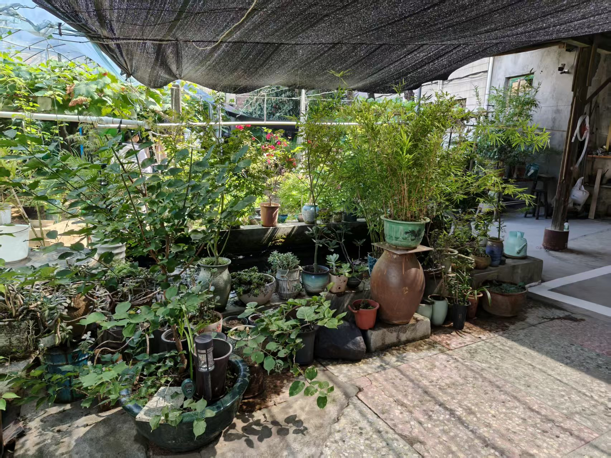

院里养着走地鸡，菜垄间踱步，扑棱翅膀刨土。母鸡下蛋，姑妈每天去鸡窝摸一把，攒一小筐，新鲜得还带着温。

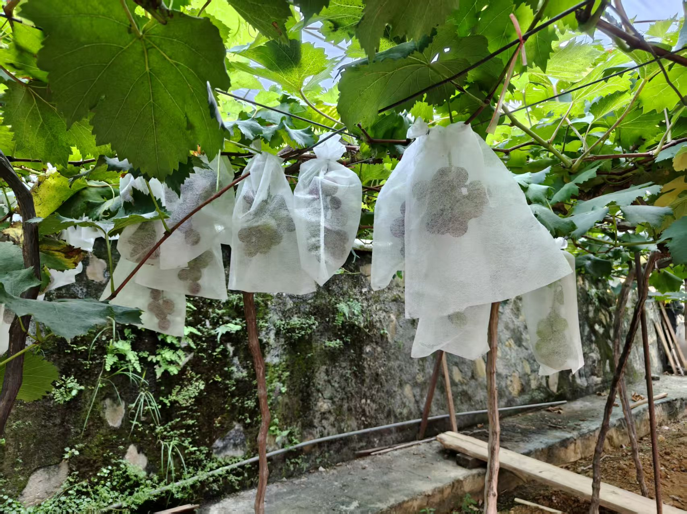

靠墙一角是鱼池，锦鲤大大小小游着，红的黄的都有。水是山泉，细细引过来，养鱼、浇地两不误。龙岩山泉水多，姑妈家占了地利。水声不大，却一直没停，听着心里就静。

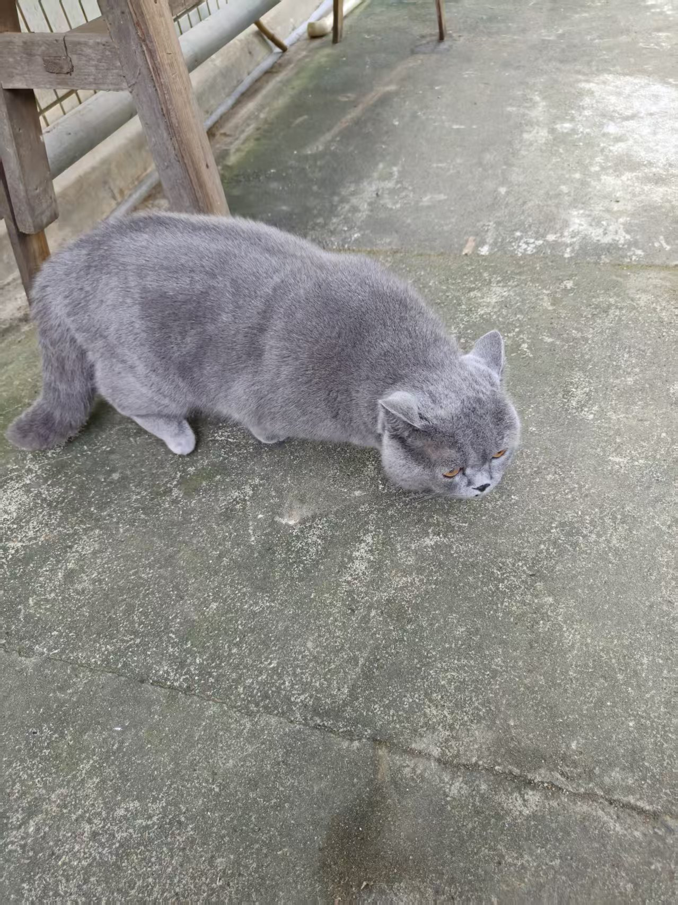

菜也不少。冬瓜趴在架上，胖嘟嘟；豇豆一绺绺垂下来；丝瓜顺着架爬，开着嫩黄小花。一日三餐，院子走一圈就齐了。

花也种了一院子，我只认得几种——鸡冠花红得发紫，月季一茬茬开，三角梅爬上墙头，红得张扬。其余叫不上名的，点缀在角落。

再往里走，多肉一盆盆挤在架子上，胖乎乎的可爱。品种多得叫不上名，有的像莲花，有的像小熊掌，肉嘟嘟地讨人喜欢，几日不浇水也精神。高高的棕榈树撑在院子一角，遮下一片阴凉。

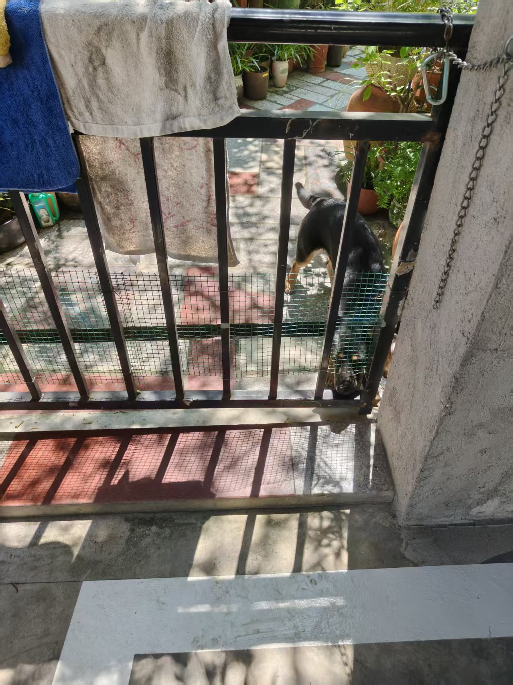

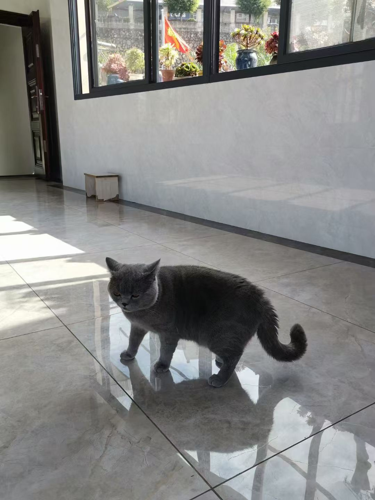

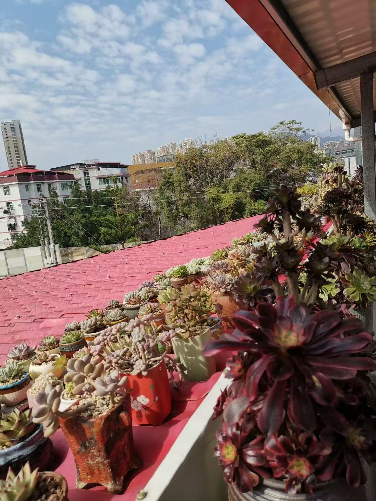

院里还养着条狗，见人不吠，摇尾巴蹭裤脚，姑妈走到哪它跟到哪。午后趴树荫下打盹，耳朵一抖一抖，比人还自在。一把藤椅，一壶茶，姑妈姑丈的下午就这么过去了。这光景，说是休闲，倒更像是从容。

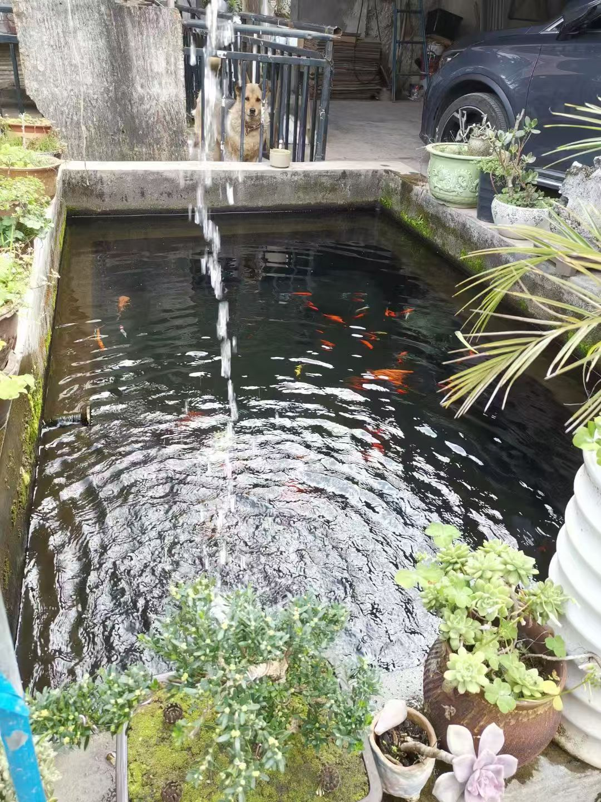

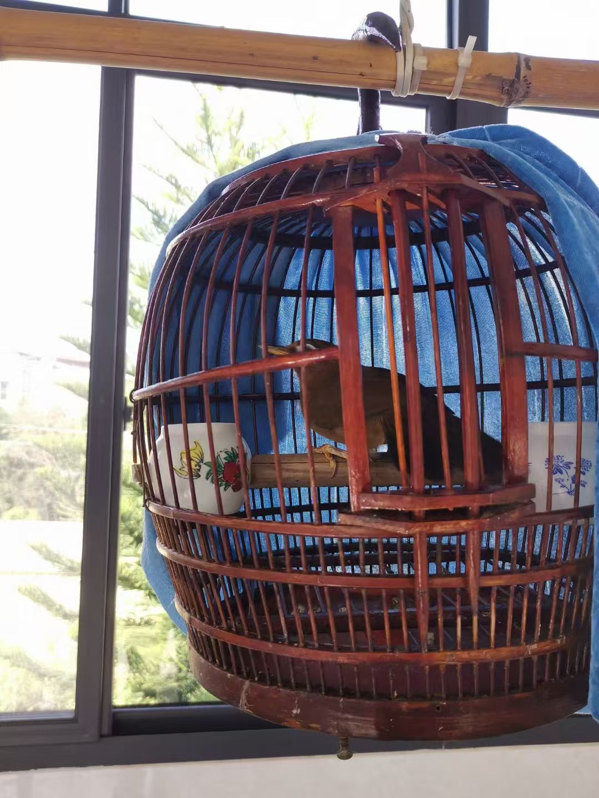

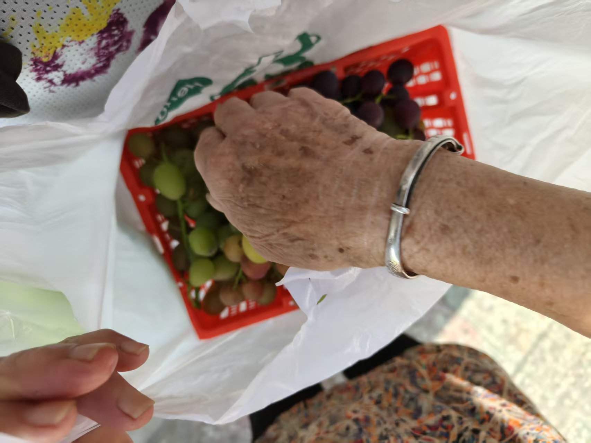

坐在院子里，吃着自家摘的葡萄，看着鸡啄食、鱼游水，我有点走神。这样的日子，在大城市想都不敢想——寸土寸金，哪来三百平的院子？可在龙岩这种小城，倒不难。退了休，子女住得近，互相有照应，日子松快舒展。

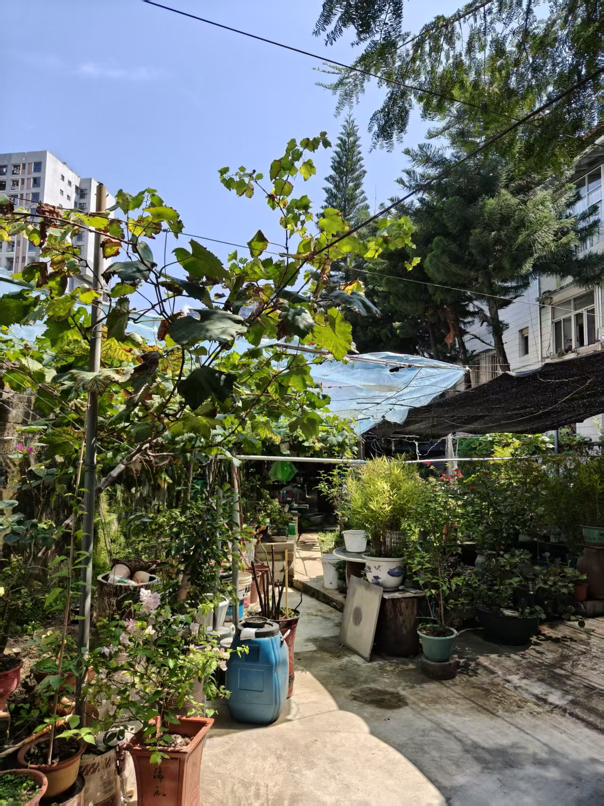

也不知等我们老去那天，能不能也有一份这样的从容。城里灯再亮，也比不上自家院里那丛三角梅，开得自在。

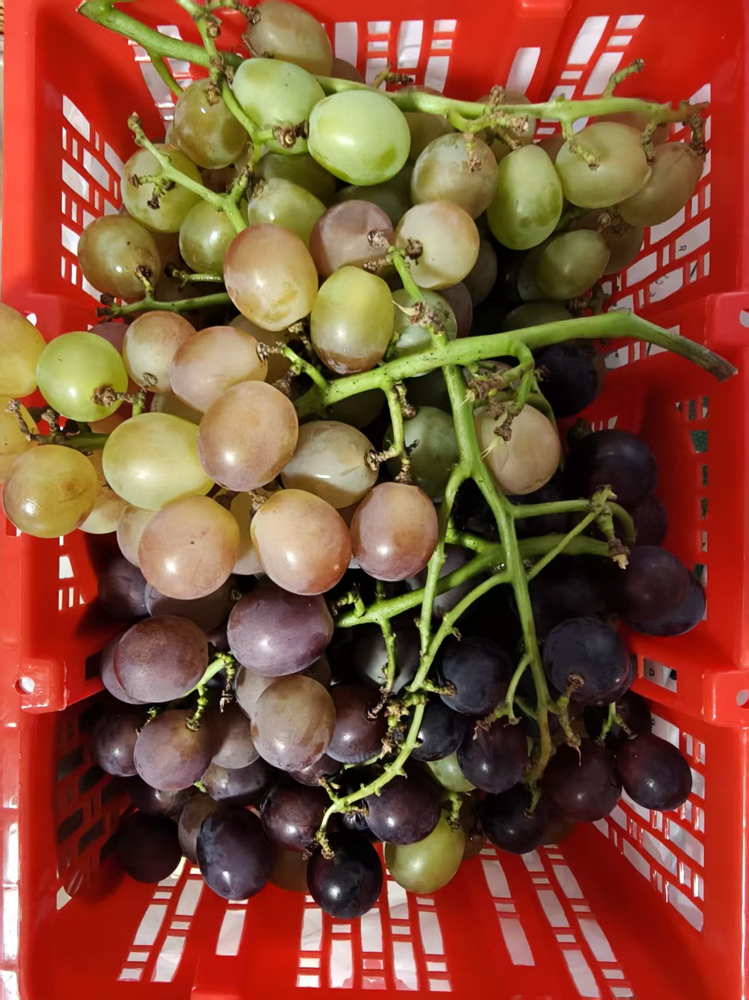

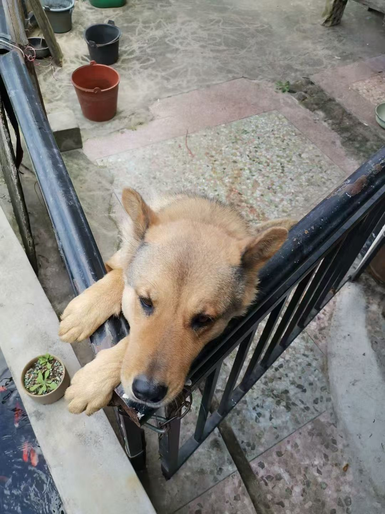
